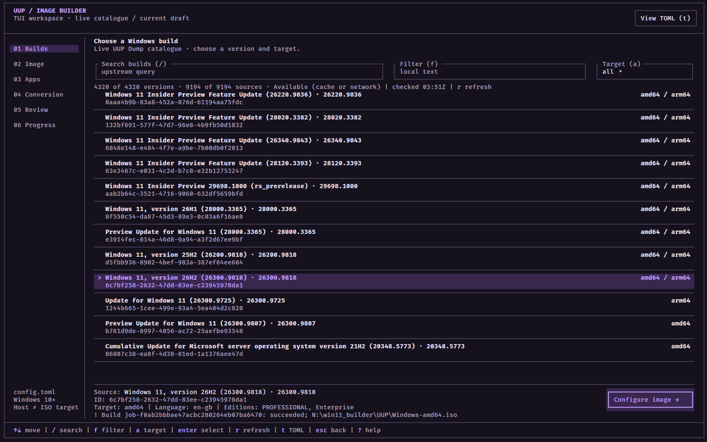
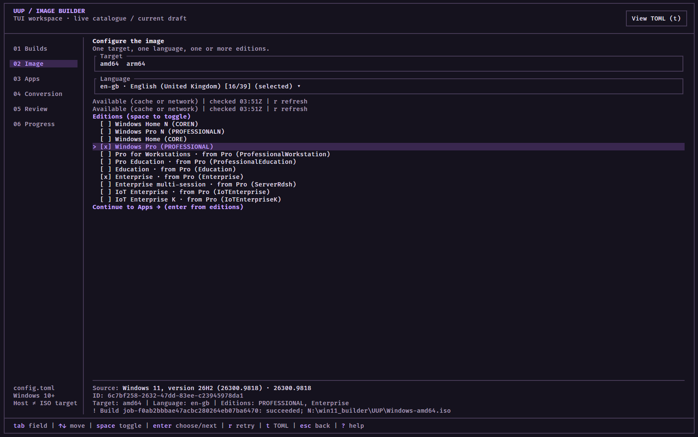
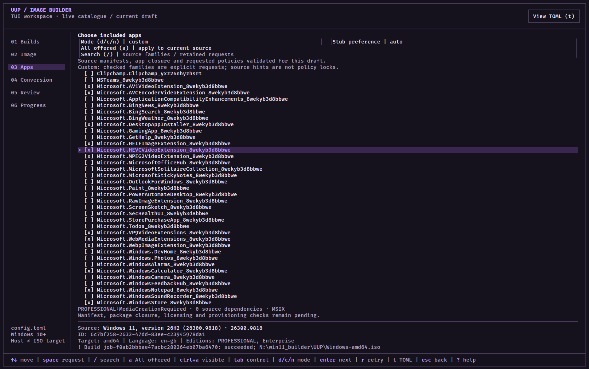
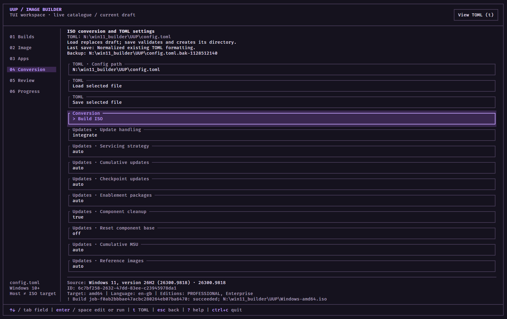
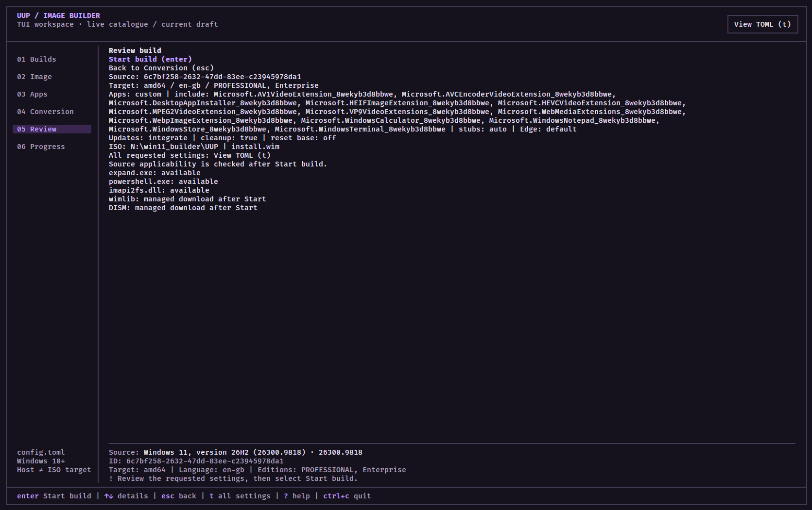
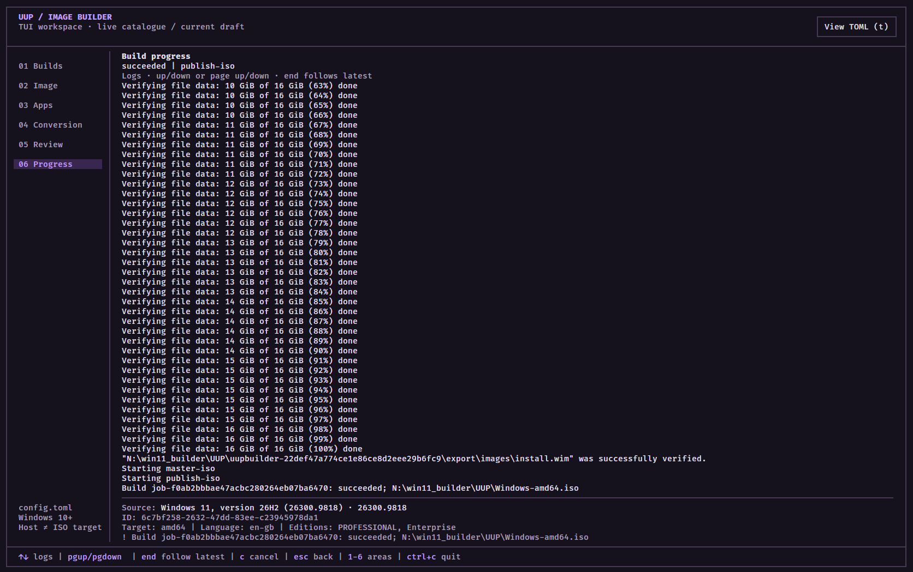
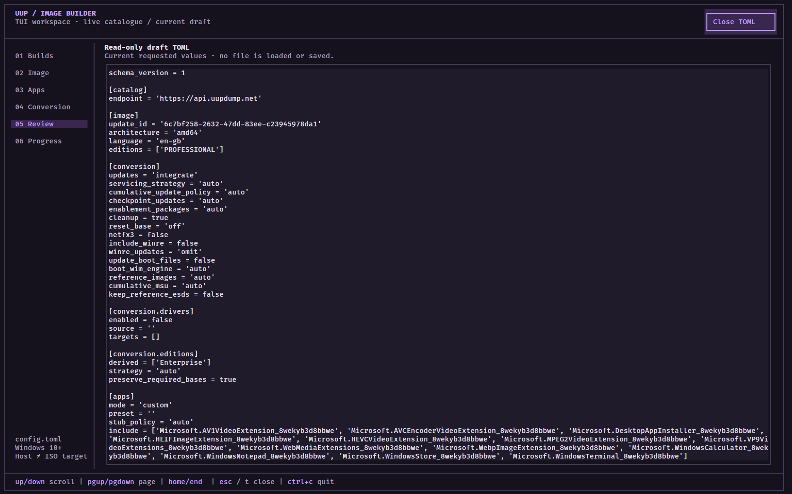

# UUP Builder

UUP Builder creates custom Windows ISO images from the component packages and apps published for Microsoft Windows builds. Choose a build, architecture, language, editions and app selection, then configure how the image is assembled through a terminal interface.

Unlike a debloater or a project such as tiny11, which starts with an already released full ISO and removes parts, UUP Builder starts with Unified Update Platform (UUP) components. It uses the UUP Dump catalogue to discover builds and obtains the selected Windows packages from Microsoft's servers, then assembles and services the image into an ISO. A full Windows ISO is not the starting point.

> **Project status:** Source layouts, servicing options and host/target combinations are subject to applicability checks. Complete end-to-end native validation and boot/Setup execution are not yet established across the supported choices. See the [host proof policy](docs/engineering/host-proof-policy.md) and [toolchain evidence](docs/feasibility/toolchains.md) for the current validation limits.

## What you can configure

- Browse and search the live catalogue for a Windows build and target architecture.
- Select a language and one or more available editions, including additional editions derived from a selected base when the source supports them.
- Use the default app selection, select apps, or request no apps.
- Configure update integration, optional .NET 3.5 and drivers, output settings, download behavior and storage.
- Choose WIM, ESD or split SWM as the image format **inside** the ISO.
- Review the requested build and required tools before starting downloads and conversion.
- Save and load a TOML configuration for reuse.

Available selections depend on the source. A setting in the interface is a request, not a guarantee that every build or host can service it. The current deliverable is an ISO; standalone image or directory output and dedicated WinRE servicing are outside the current scope.

## Requirements

- Windows 10 or later for native image operations.
- An internet connection for catalogue access, Windows packages and any required managed tools.
- Sufficient free disk space for downloads, temporary working files and the resulting ISO. Automatic workspaces require a local NTFS filesystem.
- Administrator privileges for offline image servicing. Run the application from an elevated terminal when building.
- Go 1.27.0 to build the application from source.

## Build and run

From the repository root in PowerShell:

```powershell
go build -o uupbuilder.exe ./cmd/uupbuilder
.\uupbuilder.exe
```

To open an existing configuration instead:

```powershell
.\uupbuilder.exe --config C:\path\to\config.toml
```

The default configuration path is `UUP\config.toml` beside the executable. Automatic workspace and cache locations also use the adjacent `UUP` directory. With the default configuration, the default output directory is that same `UUP` directory. It is created when a build needs it, or when you explicitly save a configuration there. Relative paths in a configuration are resolved against that configuration file's directory. See [Configuration](docs/configuration.md) for the full schema, defaults and path behavior.

## Create an ISO

### 1. Choose a build

Search or filter the catalogue and select the Windows build and target architecture you want.



### 2. Select the image

Choose the language and editions for the selected build. Additional editions can be requested from an appropriate base where available.



### 3. Choose apps

Keep the default app policy or customize the apps requested for the image. App availability and dependencies are checked against the selected source.



### 4. Configure conversion

Set the output and servicing options, including updates, image format, optional drivers and storage policies.



### 5. Review and start

Select **Build ISO** to open Review. Check the source, selections, output and tools, then select **Start build**. Source resolution, downloads and conversion begin after that confirmation.



### 6. Follow progress

The Progress screen shows build stages and logs. Press `c` to cancel and wait for active work and cleanup to finish.



### Configuration

Press `t` to inspect the current draft as TOML. The Conversion area also lets you load or save a configuration; viewing the draft alone does not save it.



## Development

Tests live alongside the Go packages. Run the source-package tests and static checks from the repository root:

```powershell
go test ./cmd/... ./internal/... ./tests/... -count=1
go vet ./cmd/... ./internal/... ./tests/...
```

Native functionality requires Windows; some live and provider tests require additional tags, fixtures or host setup. See the [engineering contracts](docs/engineering/contracts.md) and [host proof policy](docs/engineering/host-proof-policy.md) for details.
